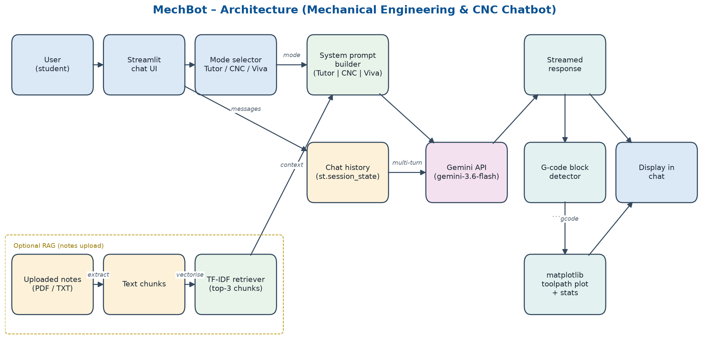
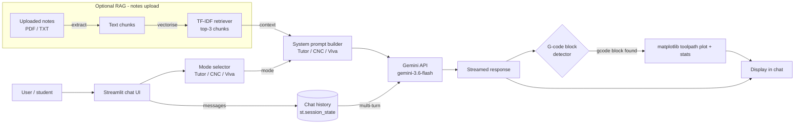

# ⚙️ MechBot – Mechanical Engineering & CNC Chatbot

MechBot is an AI chatbot for mechanical engineering students, built with **Streamlit** and **Google Gemini**.
It is one conversational chat interface: a sidebar **mode** changes how the bot behaves. It can teach core subjects, write and debug CNC G-code (and plot the toolpath), or run a mock viva.

> Built by **Afras**, final-year Mechanical Engineering, **VIT Chennai** (AI-Chatbot assignment).

---

## 🧭 Modes

| Mode | What MechBot does |
|------|-------------------|
| 📘 **Tutor** | Explains thermodynamics, heat transfer, fluid mechanics, SOM, machine design, TOM, manufacturing and metrology as **intuition → formula (LaTeX) → worked example → common mistakes**. |
| 🛠️ **CNC Assistant** | Explains Fanuc-style G/M codes, debugs pasted programs line by line, flags unsafe moves (G00 into material, missing M03/M06/M08, no safe Z retract, missing G21/G90) and writes metric/absolute programs in ```` ```gcode ```` blocks. The **toolpath is plotted automatically** under the reply. |
| 🎓 **Viva** | Acts as a viva examiner: one question at a time, scores each answer out of 10 with a short ideal answer, gets harder, and after 5 questions gives a total out of 50 plus topics to revise. |

Switching modes keeps the chat history and inserts a small "Switched to … mode" note.

## ✨ Features

- Multi-turn chat with full conversation memory (`st.session_state`), streamed responses
- Mode-specific system prompts and starter questions
- Stays on topic: politely refuses non-mechanical questions
- SI units and LaTeX formulas (`$...$`) rendered by Streamlit
- **G-code toolpath preview** (pure Python, no LLM): G00 dashed rapids, G01 solid feeds, G02/G03 arcs using I/J or R, G90/G91, modal codes, comments in `()` or `;`, plus stats (lines, rapid distance, cutting distance, X/Y extents). Malformed lines are skipped with a warning.
- **Upload your notes** (PDF/TXT): text is chunked and searched with TF-IDF; the top 3 chunks are added to the prompt and shown under "Sources used"
- Clear chat, download chat as `.md` or `.txt`
- Friendly errors for a missing or invalid key, rate limits and network problems

## 🏗️ Architecture





Regenerate the PNG with `python assets/make_schema.py`.

### Project structure

```
mechbot/
├── app.py                  # Streamlit UI: sidebar, chat loop, rendering
├── utils/
│   ├── llm.py              # Gemini client, streaming, friendly errors (MODEL_NAME lives here)
│   ├── prompts.py          # Base + mode system prompts, starter questions
│   ├── gcode_plot.py       # G-code parser, toolpath plot, stats
│   └── rag.py              # PDF/TXT text extraction, chunking, TF-IDF retrieval
├── .streamlit/
│   ├── config.toml         # Theme
│   └── secrets.toml.example
├── assets/
│   ├── schema.png          # Architecture diagram
│   ├── make_schema.py      # Script that draws schema.png
│   ├── sample_notes.txt    # Notes to try the upload feature
│   └── screenshots/
├── tests/test_gcode_plot.py
├── requirements.txt
└── README.md
```

## 🧰 Tech stack

- Python 3.10+
- Streamlit (`st.chat_input`, `st.chat_message`, `st.write_stream`)
- Google Gemini via the official `google-genai` SDK, model `gemini-3.6-flash`
- matplotlib (toolpath plots, architecture diagram)
- scikit-learn `TfidfVectorizer` + pypdf (notes retrieval)
- pytest

## 🚀 Setup (local)

```bash
git clone https://github.com/<your-username>/mechbot.git
cd mechbot
python3 -m venv venv
source venv/bin/activate          # Windows: venv\Scripts\activate
pip install -r requirements.txt
```

Add your Gemini API key (free at <https://aistudio.google.com/apikey>):

```bash
cp .streamlit/secrets.toml.example .streamlit/secrets.toml
# then edit .streamlit/secrets.toml and paste your key
```

Run:

```bash
streamlit run app.py
```

Run the tests:

```bash
pytest -q
```

## ☁️ Deploy on Streamlit Community Cloud

1. Push this repo to GitHub (the real `secrets.toml` is git-ignored and never uploaded).
2. Go to <https://share.streamlit.io> → **Create app** → pick the repo, branch `main`, main file `app.py`.
3. Open **Advanced settings → Secrets** and paste:
   ```toml
   GEMINI_API_KEY = "your-real-key"
   ```
4. Deploy. To change the key later, use **App settings → Secrets**.

## 💬 Example conversations

**Tutor**
> **You:** Explain the Carnot cycle
> **MechBot:** *Intuition:* an ideal engine that takes heat at a constant high temperature and rejects it at a constant low temperature… *Formula:* $\eta = 1 - \dfrac{T_L}{T_H}$ (temperatures in K)… *Example:* between 800 K and 300 K, $\eta = 62.5\%$… *Common mistakes:* using °C instead of K…

**CNC Assistant**
> **You:** Write G-code for a 40x40 mm square contour
> **MechBot:** a ```` ```gcode ```` program with G21 G90, T1 M06, S1200 M03, M08, a safe Z retract, the four G01 sides, M09 M05 and M30, followed by "⚠️ Verify this program in a CNC simulator…". A toolpath plot and stats appear under the reply.

**Viva**
> **You:** Start a viva on Strength of Materials
> **MechBot:** **Question 1 of 5:** Define Young's modulus and state its SI unit.
> **You:** It is stress divided by strain, unit is pascal.
> **MechBot:** **Score: 8/10**: correct, but mention it is valid only within the elastic limit… **Question 2 of 5:** …

## 🖼️ Screenshots

_Add screenshots to `assets/screenshots/` and they will show here._

| Tutor | CNC + toolpath | Viva |
|-------|----------------|------|
|  |  |  |

## ⚠️ Safety note

G-code produced by an AI model **can be wrong**. Always verify it in a CNC simulator (for example CAMotics or NC Viewer), do a dry run above the part, and check tool offsets, work offsets and feeds before running it on a real machine. The toolpath preview only shows X/Y motion and does not check for collisions.

## 🔮 Future improvements

- 3D (XYZ) toolpath view and simple collision/depth checks
- Canned cycle (G81–G83) and cutter compensation (G41/G42) support in the plotter
- Embedding-based retrieval for larger note collections
- Viva score history and progress charts
- Voice input for viva practice
- Unit converter and material property lookup tools
